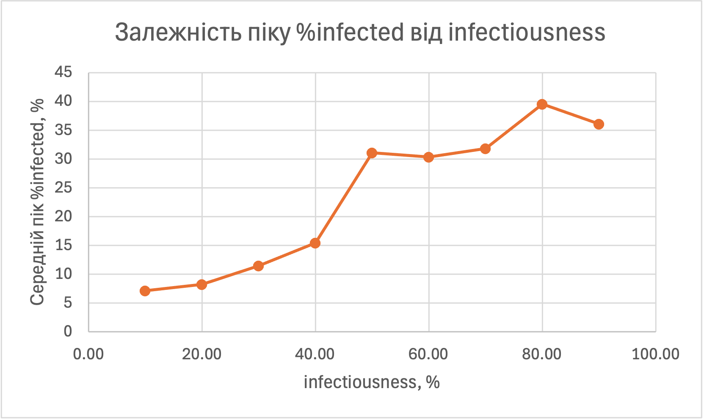
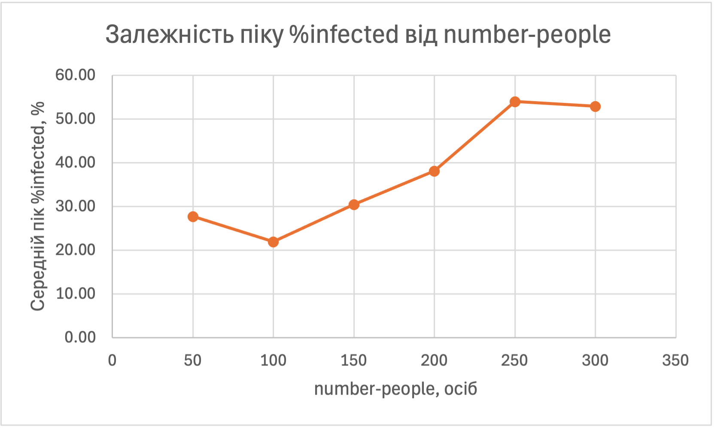
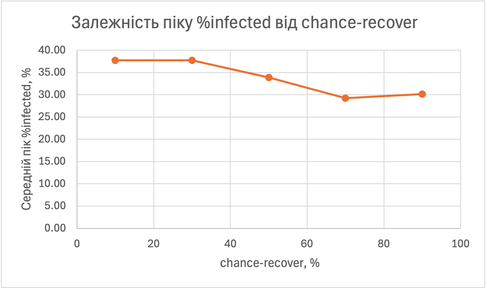

## Комп'ютерні системи імітаційного моделювання
## СПм-25-1, **Буряк Вʼячеслав Андрійович**
### Лабораторна робота №**1**. Опис імітаційних моделей та проведення обчислювальних експериментів

 

### Варіант 3, модель у середовищі NetLogo:
[Virus](https://www.netlogoweb.org/launch#https://www.netlogoweb.org/assets/modelslib/Sample%20Models/Biology/Virus.nlogo)

 

### Вербальний опис моделі:
Симуляція поширення вірусу в популяції людей. Кожна людина моделюється агентом, який випадково переміщується полем. Хворі агенти заражають здорових і неімунних, що опинилися поруч (на тій самій клітинці), з певною імовірністю. Через певний час хвороби агент або одужує і набуває тимчасового імунітету, або помирає. Здорові агенти можуть народжувати нових (з імовірністю 1% на кожному такті, поки чисельність популяції менша за ліміт), а всі агенти старіють і зрештою помирають від старості. Модель показує, як залежно від властивостей вірусу та щільності населення епідемія може швидко згаснути або охопити значну частину популяції.

Початково хворими є 10 агентів. Один такт моделі (tick) відповідає одному тижню.

### Керуючі параметри:
- **number-people** визначає початкову кількість агентів (людей) у середовищі моделювання.
- **infectiousness** визначає імовірність (у %) того, що хворий агент заразить здорового неімунного агента на тій самій клітинці на кожному такті.
- **chance-recover** визначає імовірність (у %) того, що агент одужає (і отримає імунітет) після закінчення періоду хвороби; інакше агент помирає.
- **duration** визначає тривалість хвороби (у тижнях), після якої агент або одужує, або помирає.
- **turtle-shape** визначає вигляд агентів на полі (лише візуальне налаштування, на результати не впливає).

### Внутрішні параметри:
- **sick?**. Ознака того, що агент хворий.
- **remaining-immunity**. Кількість тактів, що залишилась до закінчення імунітету агента.
- **sick-time**. Кількість тижнів, що агент вже хворіє.
- **age**. Вік агента (у тижнях).
- **lifespan**. Максимальна тривалість життя агента: 50 років (2600 тижнів). Загальний параметр для всіх агентів.
- **carrying-capacity**. Максимальна кількість агентів, яку може вмістити середовище: 300. Загальний параметр.
- **immunity-duration**. Тривалість імунітету після одужання: 52 тижні. Загальний параметр.
- **chance-reproduce**. Імовірність народження нового агента здоровим агентом на кожному такті: 1%. Загальний параметр.

### Показники роботи системи:
- **%infected**: відсоток хворих агентів від загальної чисельності популяції на поточному такті.
- **%immune**: відсоток агентів з імунітетом.
- **years**: час, що минув з початку симуляції, у роках.
- графік **Populations**: кількість хворих (sick), здорових (healthy), імунних (immune) та загальна кількість людей (total) у часі.

### Примітки:
Початкова ситуація: більшість агентів здорові, 10 агентів хворі. При малій заразності (infectiousness = 10%) вірус не поширюється: хворі зникають із популяції приблизно за 20 тижнів, а чисельність людей за рахунок народжень зростає до ліміту в 300. При високій заразності спочатку відбувається швидке зростання кількості хворих (спалах епідемії), після чого хворих стає все менше. У запусках, що тривали значно довше за 100 тактів, після початкового спалаху хвороба зникала з популяції, а чисельність людей виходила на ліміт.

### Недоліки моделі:
- Рух агентів повністю випадковий: у реальності люди мають постійні маршрути та контакти (дім, робота).
- Немає карантину, лікування та вакцинації, тому не можна дослідити заходи боротьби з епідемією.
- Імунітет однаковий для всіх агентів і має фіксовану тривалість (52 тижні), яку не можна змінити слайдером.
- Заразитися можна лише на одній клітинці з хворим, відстань і тривалість контакту не враховуються.
- Усі агенти однакові за вразливістю: вік, стан здоров'я тощо не впливають на перебіг хвороби.
- Максимальна чисельність популяції жорстко обмежена (300), тому щільність населення не можна збільшувати довільно.

 

## Обчислювальні експерименти

> Кожен запуск тривав 100 тактів (тижнів). Показником є пік %infected, тобто максимальний відсоток хворих серед усіх тактів запуску. Для кожного значення параметра виконано 3 запуски (кожен починався з натискання setup), у таблиці наведено середнє. Пік обчислювався командою `let m 0 repeat 100 [ go set m max (list m ((count turtles with [sick?] / count turtles) * 100)) ] show precision m 1`.

### 1. Вплив заразності вірусу на відсоток хворих
Досліджується залежність піку %infected (максимального відсотка хворих за перші 100 тактів) від параметра **infectiousness**.  
Експерименти проводяться при infectiousness від 10% до 90%, з кроком 10, усього 9 значень.  
Інші керуючі параметри мають значення за замовчуванням:
- **number-people**: 150
- **chance-recover**: 75
- **duration**: 20

| infectiousness, % | Запуск 1 | Запуск 2 | Запуск 3 | Середній пік %infected |
| ----------------- | -------- | -------- | -------- | ---------------------- |
| 10                | 7,4      | 7,3      | 6,6      | 7,10                   |
| 20                | 9,4      | 8,7      | 6,6      | 8,23                   |
| 30                | 11,0     | 12,0     | 11,4     | 11,47                  |
| 40                | 16,7     | 15,3     | 14,3     | 15,43                  |
| 50                | 34,7     | 32,7     | 25,9     | 31,10                  |
| 60                | 29,0     | 27,0     | 35,1     | 30,37                  |
| 70                | 29,8     | 31,4     | 34,3     | 31,83                  |
| 80                | 40,4     | 36,9     | 41,3     | 39,53                  |
| 90                | 33,5     | 40,3     | 34,4     | 36,07                  |

**Висновок:** Пік частки хворих зростає разом із заразністю вірусу, але нерівномірно. При infectiousness 10% пік (7,1%) майже збігається з початковою часткою хворих (10 із 150, тобто 6,7%): вірус практично не поширюється. До 40% епідемія залишається слабкою (піки 7–15%). Між 40% і 50% відбувається різкий стрибок до приблизно 31%, після чого при подальшому збільшенні заразності пік виходить на плато 30–39%. Різниця між значеннями 50–90% порівнянна з розкидом між окремими запусками, тому в цій області залежність слабка. Ймовірне пояснення: при високій заразності майже кожен контакт з хворим призводить до зараження, і пік обмежується вже не вірусом, а швидкістю руху агентів, тривалістю хвороби та появою імунних агентів.

### 2. Вплив щільності населення на відсоток хворих
Досліджується залежність піку %infected (максимального відсотка хворих за перші 100 тактів) від початкової кількості людей **number-people**.  
Експерименти проводяться при number-people від 50 до 300, з кроком 50, усього 6 значень.  
Інші керуючі параметри мають значення за замовчуванням:
- **infectiousness**: 65
- **chance-recover**: 75
- **duration**: 20

| number-people | Запуск 1 | Запуск 2 | Запуск 3 | Середній пік %infected |
| ------------- | -------- | -------- | -------- | ---------------------- |
| 50            | 31,6     | 29,8     | 21,8     | 27,73                  |
| 100           | 29,1     | 19,0     | 17,9     | 22,00                  |
| 150           | 28,2     | 30,8     | 32,4     | 30,47                  |
| 200           | 38,0     | 44,1     | 32,4     | 38,17                  |
| 250           | 56,7     | 54,8     | 50,5     | 54,00                  |
| 300           | 60,1     | 52,5     | 46,3     | 52,97                  |

**Висновок:** Із ростом щільності населення пік частки хворих у цілому зростає: від 22% при 100 людях до 54% при 250. Чим більше агентів на полі, тим частіше вони опиняються на одній клітинці, тому вірус поширюється швидше. Поведінка при малій кількості людей виглядає нетипово: при 50 людях пік (27,7%) вищий, ніж при 100 (22,0%). Це пояснюється тим, що початково хворі 10 агентів складають 20% від 50 людей і лише 10% від 100, тобто пік не може бути меншим за початкову частку хворих. Між 250 і 300 людьми значення практично однакові (54,0% і 53,0%), різниця менша за розкид між запусками. Імовірно, це пов'язано з обмеженням популяції в 300 агентів. Розкид між запусками при кожному значенні досить великий (наприклад, 46–60% при 300 людях).

### 3. Вплив імовірності одужання на відсоток хворих
Досліджується залежність піку %infected (максимального відсотка хворих за перші 100 тактів) від імовірності одужання **chance-recover**.  
Експерименти проводяться при chance-recover = 10, 30, 50, 70, 90%, усього 5 значень.  
Інші керуючі параметри мають значення за замовчуванням:
- **number-people**: 150
- **infectiousness**: 65
- **duration**: 20

| chance-recover, % | Запуск 1 | Запуск 2 | Запуск 3 | Середній пік %infected |
| ----------------- | -------- | -------- | -------- | ---------------------- |
| 10                | 45,2     | 27,9     | 40,2     | 37,77                  |
| 30                | 39,9     | 34,7     | 38,7     | 37,77                  |
| 50                | 36,8     | 30,5     | 34,4     | 33,90                  |
| 70                | 24,7     | 35,9     | 27,1     | 29,23                  |
| 90                | 28,0     | 32,3     | 30,1     | 30,13                  |

**Висновок:** Зі збільшенням імовірності одужання пік частки хворих дещо знижується: від 37,8% при chance-recover 10–30% до 29–30% при 70–90%. Різниця між сусідніми значеннями невелика й часто менша за розкид між запусками (наприклад, 27,9–45,2% при chance-recover 10%), тому надійно можна говорити лише про загальну тенденцію. Значення при 70% та 90% практично збігаються. Можливе пояснення: при низькому chance-recover більшість хворих після завершення хвороби помирає, а не стає імунною, тому в популяції менше імунних агентів, які б заважали поширенню вірусу.

### Загальні висновки
Найсильніше на пік епідемії впливають заразність вірусу та щільність населення: при їх збільшенні пік зростає з 7–8% до 35–55% хворих. Вплив імовірності одужання значно слабший. У всіх експериментах результати окремих запусків помітно відрізняються, що пояснюється випадковістю моделі, тому для достовірних висновків використовувалось середнє по трьох запусках.
