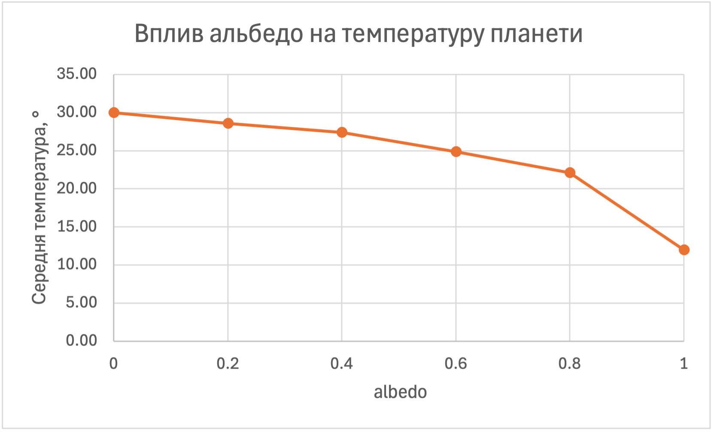
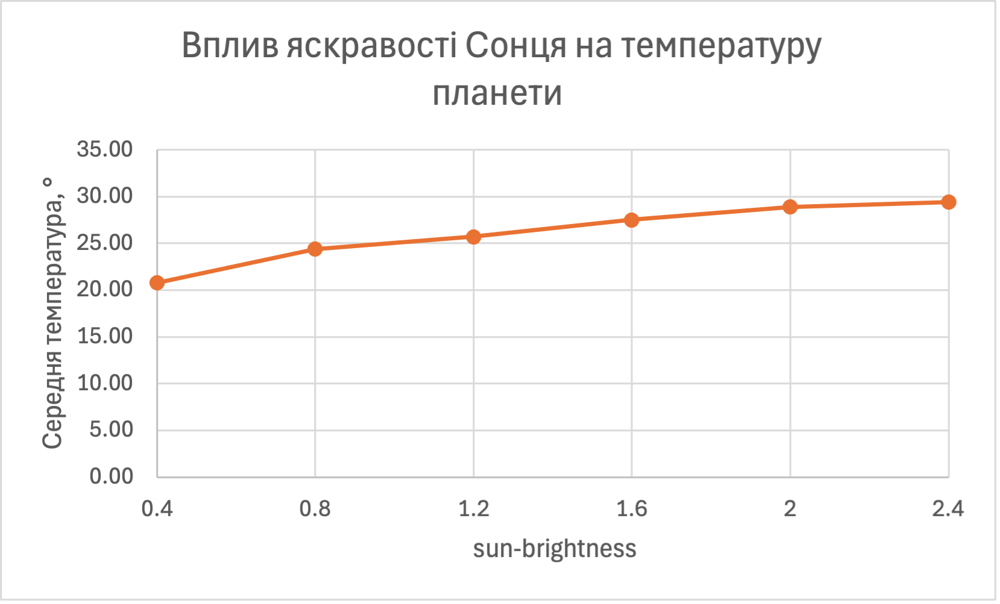
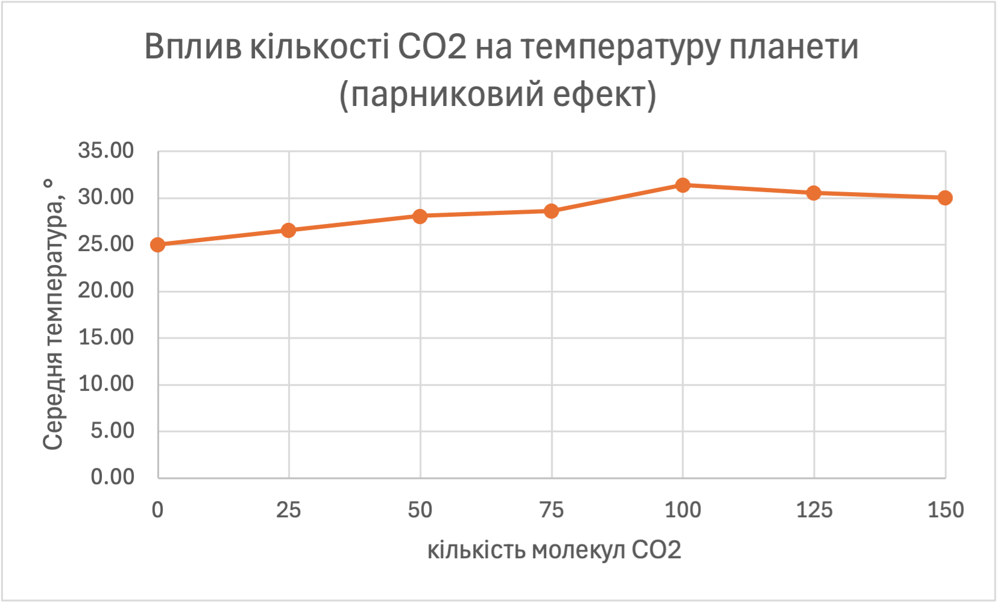
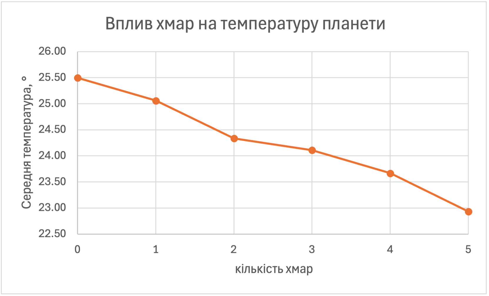

## Комп'ютерні системи імітаційного моделювання
## СПм-25-1, **Буряк Вʼячеслав Андрійович**
### Лабораторна робота №**1**. Опис імітаційних моделей та проведення обчислювальних експериментів

 

### Варіант 2, модель у середовищі NetLogo:
[Climate Change](http://www.netlogoweb.org/launch#http://www.netlogoweb.org/assets/modelslib/Sample%20Models/Earth%20Science/Climate%20Change.nlogo)

> Звіт підготовлено в рамках відпрацювання за «планом Б» (разом зі звітом по варіанту 3, Virus).

 

### Вербальний опис моделі:
Модель потоку енергії, зокрема теплової, на планеті та в її атмосфері. Сонце випромінює «пакети» сонячного світла (жовті стрілки), які рухаються вниз до поверхні Землі. Частина світла відбивається від хмар. На поверхні Землі частина енергії відбивається (залежно від альбедо), а частина поглинається й перетворюється на тепло (червоні точки). Тепло Земля повертає в атмосферу у вигляді інфрачервоного (IR) випромінювання. Хмари блокують сонячне світло, але не IR, а молекули CO2 блокують IR, але не сонячне світло: частина IR-випромінювання відбивається ними назад до Землі, що й моделює парниковий ефект. IR, що вийшло за межі атмосфери, втрачається в космосі. Температура планети залежить від кількості тепла на Землі.

### Керуючі параметри:
- **sun-brightness** (від 0 до 5, за замовчуванням 1,0) визначає, скільки сонячної енергії надходить в атмосферу. Значення 1,0 відповідає нашому Сонцю, більші значення відповідають ситуації, коли Земля ближча до Сонця або Сонце яскравіше.
- **albedo** (від 0 до 1, за замовчуванням 0,6) визначає частку сонячної енергії, яка відбивається поверхнею Землі. При albedo = 0 вся енергія поглинається, при albedo = 1 вся відбивається.
- **add CO2 / remove CO2** додають або прибирають молекули CO2 (парникові гази) групами по 25, до 150 молекул.
- **add cloud / remove cloud** додають або прибирають хмари. Хмари відбивають сонячне світло, але не блокують IR. Кожне натискання add cloud додає ще одну хмару.
- **watch a ray** виділяє один промінь, щоб можна було простежити його шлях (допоміжна кнопка, на результати не впливає).

### Внутрішні параметри:
- **temperature**. Загальна температура планети. Змінна, яка змінюється протягом симуляції.
- **sky-top**, **earth-top**. Координати верхнього рядка неба та поверхні Землі. Загальні параметри.
- **cloud-speed**. Швидкість руху хмар. Загальний параметр.
- Типи агентів: **rays** (пакети сонячного світла), **IRs** (пакети інфрачервоного випромінювання), **heats** (пакети тепла), **CO2s** (молекули CO2), **clouds** (хмари, що складаються з багатьох дрібних об'єктів).

### Показники роботи системи:
- **temperature**: поточна температура планети.
- **CO2 amount**: поточна кількість молекул CO2 в атмосфері.
- графік **Global Temperature**: зміна температури планети в часі.

### Примітки:
Початкова температура планети дорівнює 12. Після запуску температура зростає, поступово сповільнюється і виходить на стабільний рівень, навколо якого лише коливається (через випадковий рух променів і частинок). Для налаштувань за замовчуванням (sun-brightness = 1,0; albedo = 0,6) без хмар і CO2 цей рівень становить близько 25 градусів.

### Недоліки моделі:
- Земля в моделі має єдине альбедо та єдину теплоємність для всієї поверхні. У реальності вони різні для океанів, льодовиків, суші тощо.
- CO2 блокує лише IR-випромінювання, хоча в реальності він частково поглинає і видиме світло; так само хмари частково відбивають IR.
- Немає океанів, льодовиків та рослинності, тому не можна дослідити зворотний зв'язок, наприклад таяння льодовиків зі зменшенням альбедо.
- CO2 лише додається або прибирається вручну, моделі джерел викидів і поглинання (заводи, ліси) немає.
- Параметри хмар (кількість, висота) не регулюються слайдером.
- Модель досить довго виходить на стабільний рівень (до 2000 тактів), що ускладнює швидкі експерименти.

 

## Обчислювальні експерименти

> Для кожного запуску виконувалась послідовність: setup → встановлення значень слайдерів та (за потреби) додавання CO2 або хмар командами add-CO2 / add-cloud → вимірювання. Показником є **стабілізована температура**: середнє значення температури за останні 100 тактів із 3100 тактів симуляції (перші 3000 тактів відводяться на вихід на стабільний рівень). Для кожного значення параметра виконано 3 запуски, у таблиці наведено середнє. Використана команда (для експериментів із CO2 та хмарами перед `let s 0` додається `repeat K [ add-CO2 ]` або `repeat K [ add-cloud ]`):
> `setup let s 0 repeat 3000 [ go ] repeat 100 [ go set s s + temperature ] show precision (s / 100) 2`

> Примітка: пробний запуск (sun-brightness = 1; albedo = 0; без CO2 і хмар) показав, що температура зростає повільно, а її приріст поступово зменшується: на 200-му, 400-му, 600-му, 800-му та 1000-му тактах вона дорівнювала 13,3; 17,2; 21,3; 24,5 та 27,0. Тобто на 1000-му такті модель ще не вийшла на стабільний рівень. Подальший запуск показав, що температура стабілізується приблизно на 1500–2000-му такті (близько 30 градусів), після чого лише коливається в межах приблизно ±0,5 градуса. Тому для виходу на стабільний рівень відводиться 3000 тактів із запасом (для параметрів, при яких температура зростає довше).

### 1. Вплив альбедо на температуру планети
Досліджується залежність стабілізованої температури від параметра **albedo**.  
Експерименти проводяться при albedo = 0; 0,2; 0,4; 0,6; 0,8; 1,0, усього 6 значень.  
Інші керуючі параметри:
- **sun-brightness**: 1,0
- кількість CO2: 0
- кількість хмар: 0

| albedo | Запуск 1 | Запуск 2 | Запуск 3 | Середня температура |
| ------ | -------- | -------- | -------- | ------------------- |
| 0      | 30,87    | 29,35    | 29,74    | 29,99               |
| 0,2    | 28,52    | 28,68    | 28,51    | 28,57               |
| 0,4    | 26,81    | 28,31    | 27,12    | 27,41               |
| 0,6    | 24,04    | 25,17    | 25,35    | 24,85               |
| 0,8    | 21,85    | 22,26    | 22,28    | 22,13               |
| 1,0    | 12,00    | 12,00    | 12,00    | 12,00               |

**Висновок:** При збільшенні альбедо стабілізована температура планети зменшується: від 30,0 при albedo = 0 до 22,1 при albedo = 0,8. Спад нерівномірний: на інтервалі 0–0,4 температура знижується приблизно на 1,3 градуса на кожні 0,2 альбедо, а на інтервалі 0,4–0,8 швидше, приблизно на 2,6 градуса. При albedo = 1,0 температура в усіх трьох запусках залишалась рівною початковому значенню (12): Земля відбиває все сонячне світло, нагрівання не відбувається. Розкид між запусками при кожному значенні невеликий (до 1,5 градуса при albedo = 0), тому залежність надійно відтворюється.

### 2. Вплив яскравості Сонця на температуру планети
Досліджується залежність стабілізованої температури від параметра **sun-brightness**.  
Експерименти проводяться при sun-brightness = 0,4; 0,8; 1,2; 1,6; 2,0; 2,4, усього 6 значень.  
Інші керуючі параметри:
- **albedo**: 0,6
- кількість CO2: 0
- кількість хмар: 0

| sun-brightness | Запуск 1 | Запуск 2 | Запуск 3 | Середня температура |
| -------------- | -------- | -------- | -------- | ------------------- |
| 0,4            | 21,24    | 21,18    | 19,87    | 20,76               |
| 0,8            | 24,51    | 24,12    | 24,51    | 24,38               |
| 1,2            | 26,22    | 25,18    | 25,74    | 25,71               |
| 1,6            | 27,43    | 27,19    | 27,94    | 27,52               |
| 2,0            | 29,94    | 27,80    | 28,94    | 28,89               |
| 2,4            | 30,01    | 29,56    | 28,76    | 29,44               |

**Висновок:** Зі збільшенням яскравості Сонця стабілізована температура зростає, але дедалі повільніше: від 20,8 при sun-brightness = 0,4 до 29,4 при 2,4. Найбільший приріст (3,6 градуса) дає перше збільшення яскравості з 0,4 до 0,8, а між 2,0 і 2,4 приріст лише 0,55 градуса, тобто крива виходить на плато біля 29–30 градусів. Дрібні нерівності (наприклад, приріст 1,3 між 0,8 і 1,2 та 1,8 між 1,2 і 1,6) порівнянні з розкидом між запусками, тому окремо їх інтерпретувати не варто. Порівняння з експериментом 1 показує, що температура визначається часткою сонячної енергії, яку поглинає Земля, тобто добутком sun-brightness × (1 − albedo): при albedo = 0 (поглинається 1,0) температура 30,0, при sun-brightness = 2,4 і albedo = 0,6 (поглинається 0,96) вона 29,4; при albedo = 0,4 (поглинається 0,6) вона 27,4, а при sun-brightness = 1,6 (поглинається 0,64) вона 27,5. Ймовірне пояснення сповільнення росту: чим гарячіша Земля, тим більше тепла вона віддає у вигляді IR-випромінювання в космос.

### 3. Вплив кількості CO2 на температуру планети (парниковий ефект)
Досліджується залежність стабілізованої температури від кількості молекул CO2 в атмосфері. Кількість задається командою `repeat K [ add-CO2 ]` після setup (кожен виклик додає 25 молекул).  
Експерименти проводяться при кількості CO2 = 0; 25; 50; 75; 100; 125; 150, усього 7 значень.  
Інші керуючі параметри:
- **sun-brightness**: 1,0
- **albedo**: 0,6
- кількість хмар: 0

| Кількість CO2 | Запуск 1 | Запуск 2 | Запуск 3 | Середня температура |
| ------------- | -------- | -------- | -------- | ------------------- |
| 0             | 24,66    | 25,14    | 25,16    | 24,99               |
| 25            | 25,06    | 27,86    | 26,69    | 26,54               |
| 50            | 28,34    | 27,89    | 28,00    | 28,08               |
| 75            | 27,32    | 28,35    | 30,17    | 28,61               |
| 100           | 31,15    | 30,76    | 32,24    | 31,38               |
| 125           | 30,10    | 30,86    | 30,73    | 30,56               |
| 150           | 30,61    | 29,77    | 29,76    | 30,05               |

**Висновок:** Додавання CO2 підвищує стабілізовану температуру планети: від 25,0 градусів без CO2 до 31,4 при 100 молекулах, тобто приблизно на 6,4 градуса. Це відповідає парниковому ефекту: молекули CO2 відбивають інфрачервоне випромінювання Землі назад, тому тепло гірше йде в космос. Після 100 молекул температура більше не зростає, а навіть трохи знижується (31,4 → 30,6 → 30,1), проте ця різниця порівнянна з розкидом між запусками (наприклад, 27,3–30,2 при 75 молекулах, 30,8–32,2 при 100), тому коректніше говорити про вихід на плато близько 30–31 градуса, ніж про реальне зниження. Нерівномірність на відрізку 50–100 молекул (приріст 0,5 між 50 і 75 та 2,8 між 75 і 100) також, імовірно, пояснюється випадковістю моделі.

### 4. Вплив хмар на температуру планети
Досліджується залежність стабілізованої температури від кількості хмар. Кількість задається командою `repeat K [ add-cloud ]` після setup (кожен виклик додає ще одну хмару).  
Експерименти проводяться при K = 0, 1, 2, 3, 4, 5, усього 6 значень.  
Інші керуючі параметри:
- **sun-brightness**: 1,0
- **albedo**: 0,6
- кількість CO2: 0

| Кількість хмар | Запуск 1 | Запуск 2 | Запуск 3 | Середня температура |
| -------------- | -------- | -------- | -------- | ------------------- |
| 0              | 25,09    | 26,22    | 25,18    | 25,50               |
| 1              | 24,88    | 24,87    | 25,43    | 25,06               |
| 2              | 23,81    | 23,56    | 25,63    | 24,33               |
| 3              | 24,26    | 24,01    | 24,06    | 24,11               |
| 4              | 23,06    | 23,66    | 24,28    | 23,67               |
| 5              | 22,30    | 22,07    | 24,43    | 22,93               |

**Висновок:** Збільшення кількості хмар знижує стабілізовану температуру планети: від 25,5 градуса без хмар до 22,9 при п'яти хмарах, тобто приблизно на 0,5 градуса на кожну додаткову хмару. Це відповідає тому, що хмари відбивають частину сонячного світла, і до поверхні Землі доходить менше енергії, а на IR-випромінювання хмари не діють. Вплив хмар у дослідженому діапазоні слабший, ніж вплив альбедо або CO2. Розкид між запусками при кількох значеннях досить великий: при 2 та 5 хмарах значення третього запуску (25,63 та 24,43) приблизно на 2 градуса вище за перші два, тому для цих двох точок середнє менш надійне.

### Загальні висновки
Температура планети в моделі визначається балансом енергії, що надходить від Сонця й поглинається Землею, та тепла, яке йде в космос. Зі збільшенням альбедо, зменшенням яскравості Сонця та додаванням хмар (вони відбивають сонячне світло) температура знижується; зі збільшенням яскравості Сонця та додаванням CO2 (він утримує IR) температура зростає. У дослідженому діапазоні найсильніше вплинуло альбедо (від 30,0 до 12,0), далі яскравість Сонця (від 20,8 до 29,4) та CO2 (від 25,0 до приблизно 31), найслабше хмари (від 25,5 до 22,9). Порівнювати розмах впливу між параметрами слід обережно, бо діапазони значень різні. Для однакових умов (sun-brightness = 1,0; albedo = 0,6; без CO2 і хмар) в експериментах 1, 3 та 4 отримано 24,85; 24,99 та 25,50, тобто випадковий розкид між серіями становить приблизно 0,65 градуса, а різниці менші за цю величину не слід вважати значущими.
