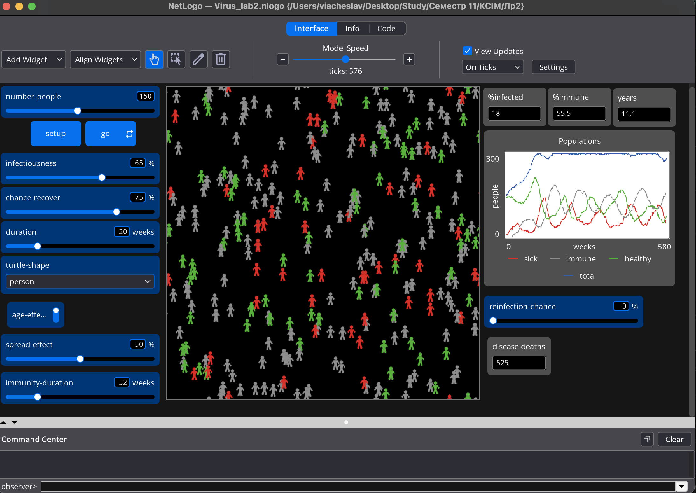
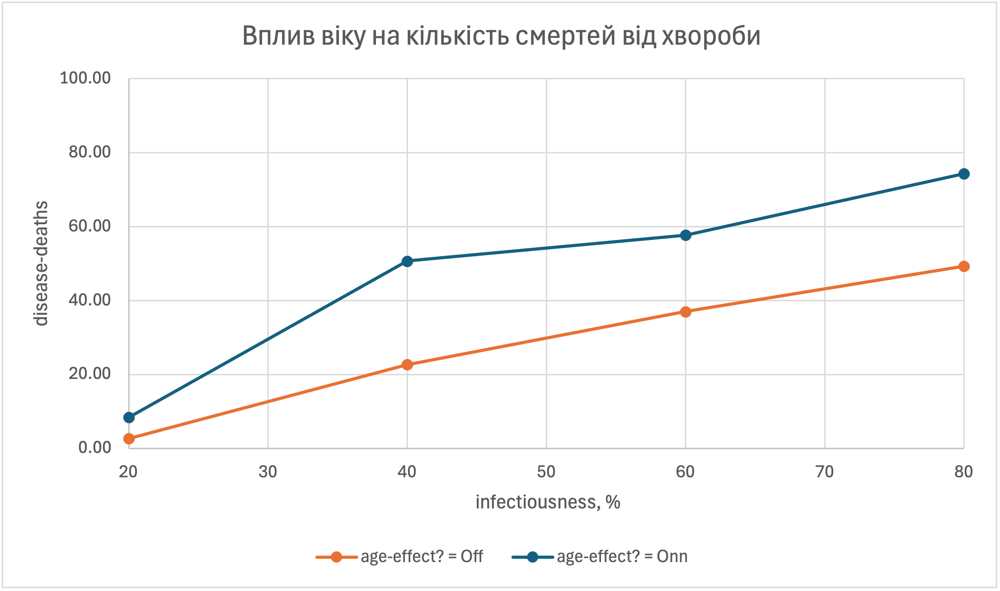

## Комп'ютерні системи імітаційного моделювання
## СПм-25-1, **Буряк Вʼячеслав Андрійович**
### Лабораторна робота №**2**. Редагування імітаційних моделей у середовищі NetLogo

<br>

# Варіант 3, модель у середовищі NetLogo:
[Virus](https://www.netlogoweb.org/launch#https://www.netlogoweb.org/assets/modelslib/Sample%20Models/Biology/Virus.nlogo)

### Внесені зміни у вихідну логіку моделі, за варіантом:

**1. Вплив віку на імовірність зараження та на перебіг хвороби.**
Додано перемикач `age-effect?` (On/Off) і дві константи в `setup-constants`: діти до 10 років (`young-age`, 520 тижнів) та літні після 35 років (`old-age`, 1820 тижнів; максимальна тривалість життя в моделі 50 років). Два нових звіти повертають коефіцієнт для поточного агента:
```netlogo
to-report age-infection-factor ;; turtle reporter
  if not age-effect? [ report 1 ]
  if age < young-age [ report 1.2 ]
  if age > old-age [ report 1.5 ]
  report 1
end

to-report age-recovery-factor ;; turtle reporter
  if not age-effect? [ report 1 ]
  if age < young-age [ report 0.9 ]
  if age > old-age [ report 0.6 ]
  report 1
end
```
Імовірність зараження тепер дорівнює `infectiousness * age-infection-factor`, а імовірність одужання (інакше агент помирає) дорівнює `chance-recover * age-recovery-factor`:
```netlogo
to recover-or-die ;; turtle procedure
  if sick-time > duration
    [ ifelse random-float 100 < chance-recover * age-recovery-factor
      [ become-immune ]
      [ set disease-deaths disease-deaths + 1
        die ] ]
end
```

**2. Вплив рівня поширення хвороби на появу нових агентів.**
Додано слайдер `spread-effect` (0–100 %). Чим більший відсоток хворих `%infected`, тим менша імовірність народження. При `spread-effect = 0` поведінка збігається з вихідною моделлю:
```netlogo
to reproduce ;; turtle procedure
  let p chance-reproduce * (1 - (spread-effect / 100) * (%infected / 100))
  if count turtles < carrying-capacity and random-float 100 < p
    [ hatch 1
      [ set age 1
        lt 45 fd 1
        get-healthy ] ]
end
```

**3. Налаштування тривалості імунітету та імовірності повторного зараження.**
Глобальна змінна `immunity-duration` (була константою 52 тижні) видалена з `globals` і `setup-constants`, натомість додано слайдер з такою ж назвою (0–260 тижнів, за замовчуванням 52). Додано слайдер `reinfection-chance` (0–100 %, за замовчуванням 0): якщо контакт із хворим мав би призвести до зараження, а агент імунний, то він таки захворіє лише з цією імовірністю. При `reinfection-chance = 0` імунні агенти, як і раніше, не хворіють:
```netlogo
to infect ;; turtle procedure
  ask other turtles-here with [ not sick? ] [
    if random-float 100 < infectiousness * age-infection-factor [
      ifelse immune?
        [ if random-float 100 < reinfection-chance [ get-sick ] ]
        [ get-sick ]
    ]
  ]
end
```

### Внесені зміни у вихідну логіку моделі, на власний розсуд:

**Лічильник смертей від хвороби.** Додано глобальну змінну `disease-deaths` (збільшується в `recover-or-die`, див. вище) та відповідний monitor на інтерфейсі. Без нього неможливо виміряти, як вік впливає на наслідки хвороби, бо загальна чисельність змінюється ще й через народження та смерть від старості.

Інші зміни в коді:
```netlogo
globals
  [ %infected
    %immune
    lifespan
    chance-reproduce
    carrying-capacity
    young-age            ;; нове: межа "дитячого" віку, тижні
    old-age              ;; нове: межа "літнього" віку, тижні
    disease-deaths ]     ;; нове: смерті від хвороби

to setup-constants
  set lifespan 50 * 52
  set carrying-capacity 300
  set chance-reproduce 1
  set young-age 10 * 52
  set old-age 35 * 52
end
```

### Зміни інтерфейсу:
| Віджет | Тип | Діапазон | За замовчуванням |
| ------ | --- | -------- | ---------------- |
| age-effect? | switch | On / Off | On |
| spread-effect | slider, % | 0–100 | 50 |
| immunity-duration | slider, тижні | 0–260 | 52 |
| reinfection-chance | slider, % | 0–100 | 0 |
| disease-deaths | monitor | | |




Фінальний код і інтерфейс моделі: [Virus_lab2.nlogox](Virus_lab2.nlogox).

## Обчислювальний експеримент (Virus)

### Вплив віку на кількість смертей від хвороби залежно від заразності вірусу
> Кожен запуск тривав 100 тактів (тижнів). Показником є `disease-deaths` на кінець запуску. Для кожного значення параметра виконано 3 запуски, у таблиці наведено середнє. Запуск: `setup repeat 100 [ go ] show disease-deaths`.

Досліджується залежність `disease-deaths` від **infectiousness** при вимкненому та ввімкненому `age-effect?`.  
Експерименти проводяться при infectiousness = 20, 40, 60, 80 %.  
Інші керуючі параметри:
- **number-people**: 150
- **chance-recover**: 75
- **duration**: 20
- **spread-effect**: 0 (щоб відокремити вплив віку)
- **immunity-duration**: 52
- **reinfection-chance**: 0

| infectiousness, % | Off: запуск 1 | Off: запуск 2 | Off: запуск 3 | Off: середнє | On: запуск 1 | On: запуск 2 | On: запуск 3 | On: середнє |
| ----------------- | ------------- | ------------- | ------------- | ------------ | ------------ | ------------ | ------------ | ----------- |
| 20                | 1             | 4             | 3             | 2,67         | 12           | 7            | 6            | 8,33        |
| 40                | 30            | 20            | 18            | 22,67        | 41           | 59           | 52           | 50,67       |
| 60                | 26            | 45            | 40            | 37,00        | 49           | 57           | 67           | 57,67       |
| 80                | 48            | 56            | 44            | 49,33        | 66           | 86           | 71           | 74,33       |



**Висновок:** При ввімкненому `age-effect?` кількість смертей від хвороби більша за весь діапазон заразності: у 3,1 раза при 20 %, у 2,2 раза при 40 %, у 1,6 та 1,5 раза при 60 % та 80 %. При високій заразності співвідношення стабілізується на рівні 1,5, що узгоджується з очікуванням за вибраними коефіцієнтами: частки дітей (20 %) та літніх (30 %) підвищують і імовірність зараження (у середньому в 1,19 раза), і імовірність смерті після хвороби (із 25 % для дорослих до 32,5 % для дітей та 55 % для літніх, у середньому 35,5 %). Дуже велике відношення при 20 % пояснюється малими абсолютними значеннями (у середньому 2,7 проти 8,3 смертей) та близькістю до порогу поширення: невелике підвищення заразності для вразливих груп робить спалах помітно ймовірнішим. У обох режимах кількість смертей зростає з заразністю, але у режимі On зростання сповільнюється після 40 % (50,7 → 57,7 → 74,3). Розкид між запусками великий (наприклад, 41–59 при 40 % у режимі On), тому різниця між 40 % та 60 % у цьому режимі знаходиться в межах похибки.