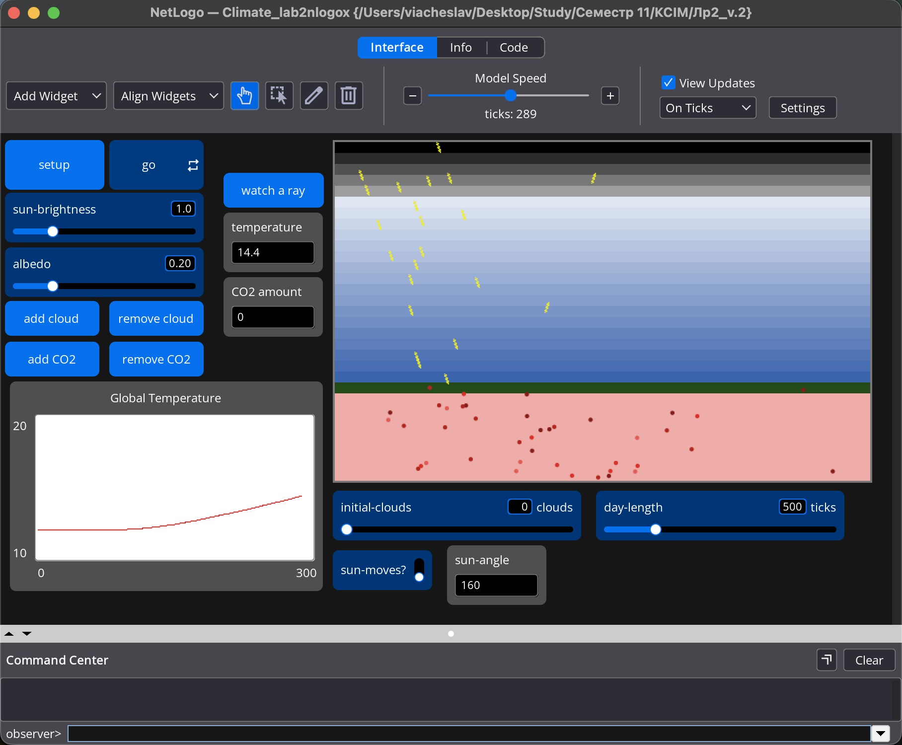
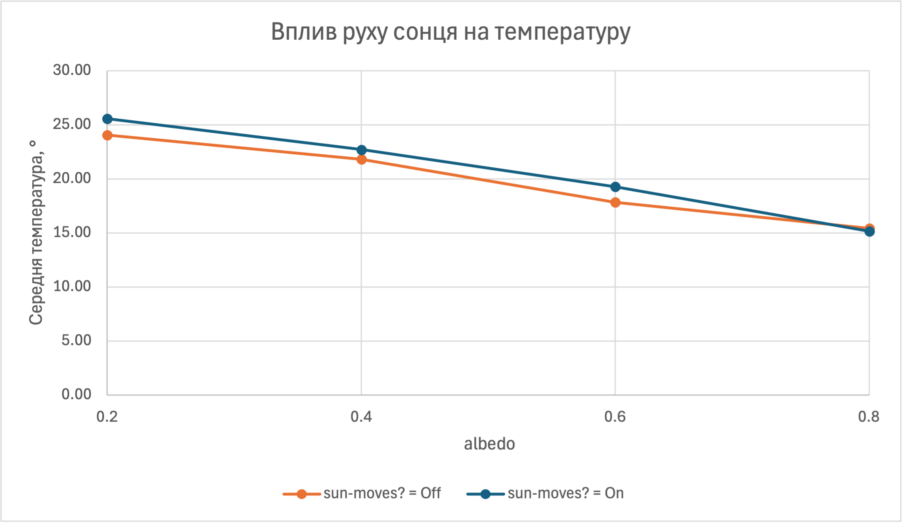

## Комп'ютерні системи імітаційного моделювання
## СПм-25-1, **Буряк Вʼячеслав Андрійович**
### Лабораторна робота №**2**. Редагування імітаційних моделей у середовищі NetLogo

<br>

### Варіант 2, модель у середовищі NetLogo:
[Climate Change](https://www.netlogoweb.org/launch#https://www.netlogoweb.org/assets/modelslib/Sample%20Models/Earth%20Science/Climate%20Change.nlogo)

<br>

### Внесені зміни у вихідну логіку моделі, за варіантом:

**1. Початкова кількість хмар.** Додано слайдер `initial-clouds` (0–10). У `setup` після створення світу вже наявна процедура `add-cloud` викликається задану кількість разів:
```netlogo
setup-world
repeat initial-clouds [ add-cloud ]
set temperature 12
```

**2. Кут падіння нових сонячних променів змінюється з часом.** Додано слайдер `day-length` (довжина доби в тактах, 100–2000, крок 50), перемикач `sun-moves?` (On/Off; при Off модель працює як вихідна: промінь під кутом 160° з фіксованої ділянки зверху) та глобальну змінну `sun-angle`, яка зберігає поточний кут.

Частка доби `phase = (ticks mod day-length) / day-length` змінюється від 0 (ранок) до 1 (вечір). Курс нових променів змінюється лінійно від 120° (сонце низько зліва) через 180° (полудень, промінь вертикально вниз) до 240° (сонце низько справа). Початкова позиція променя на верхній межі світу також рухається разом із сонцем зліва направо:
```netlogo
to create-sunshine
  let phase (ticks mod day-length) / day-length
  let chance 10 * sun-brightness
  let ray-angle 160
  let ray-x (random 10) + min-pxcor
  if sun-moves? [
    set ray-angle 120 + 120 * phase
    set chance chance * (sin (phase * 180)) * 1.57
    set ray-x min-pxcor + phase * (world-width - 10) + random 10
  ]
  set sun-angle ray-angle
  if chance > random 50 [
    create-rays 1 [
      set heading ray-angle
      set color yellow
      setxy ray-x max-pycor
    ]
  ]
end
```

### Внесені зміни у вихідну логіку моделі, на власний розсуд:

**Інтенсивність сонячного випромінювання залежить від висоти сонця.** Уранці та ввечері (низьке сонце) променів створюється менше, опівдні більше: імовірність створення променя множиться на `sin(phase * 180)`. Множник 1.57 (≈ π/2) вирівнює середнє за добу значення з вихідною моделлю, тому при однакових `sun-brightness` та `albedo` обидва режими можна порівнювати.

**Монітор `sun-angle`** показує поточний кут променів на інтерфейсі.

Нова глобальна змінна:
```netlogo
globals [
  sky-top      ;; y coordinate of top row of sky
  earth-top    ;; y coordinate of top row of earth
  temperature  ;; overall temperature
  sun-angle    ;; (нове) поточний кут нових променів
]
```

### Зміни інтерфейсу:
| Віджет | Тип | Діапазон | Призначення |
| ------ | --- | -------- | ----------- |
| initial-clouds | slider, хмари | 0–10 | початкова кількість хмар |
| day-length | slider, такти | 100–2000 | довжина доби |
| sun-moves? | switch | On / Off | увімкнення руху сонця |
| sun-angle | monitor | | поточний кут променів |



Фінальний код і інтерфейс моделі: [Climate_lab2.nlogox](Climate_lab2.nlogox).

<br>

## Обчислювальний експеримент

### Вплив руху сонця на температуру залежно від альбедо
> Кожен запуск тривав 1000 тактів (2 доби при `day-length` = 500). Показником є `temperature` на кінець запуску. Для кожного значення параметра виконано 3 запуски (кожен починався з виклику `setup`), у таблиці наведено середнє. Запуск: `setup repeat 1000 [ go ] show precision temperature 1`.

Досліджується залежність `temperature` від **albedo** при вимкненому та ввімкненому `sun-moves?`.  
Експерименти проводяться при albedo = 0,2; 0,4; 0,6; 0,8, усього 4 значення.  
Інші керуючі параметри:
- **sun-brightness**: 1,0
- **initial-clouds**: 0 (щоб прибрати випадковість від хмар)
- **day-length**: 500
- CO2 не додавався

| albedo | Off: запуск 1 | Off: запуск 2 | Off: запуск 3 | Off: середнє | On: запуск 1 | On: запуск 2 | On: запуск 3 | On: середнє |
| ------ | ------------- | ------------- | ------------- | ------------ | ------------ | ------------ | ------------ | ----------- |
| 0,2    | 24,4          | 23,7          | 24,1          | 24,07        | 25,7         | 25,3         | 25,7         | 25,57       |
| 0,4    | 22,5          | 21,0          | 21,9          | 21,80        | 23,3         | 22,3         | 22,5         | 22,70       |
| 0,6    | 17,3          | 18,6          | 17,6          | 17,83        | 17,7         | 20,0         | 20,1         | 19,27       |
| 0,8    | 15,8          | 14,9          | 15,5          | 15,40        | 15,2         | 15,5         | 14,7         | 15,13       |



**Висновок:** В обох режимах температура майже лінійно спадає із ростом albedo: від 24,1 (Off) та 25,6 (On) при 0,2 до 15,4 та 15,1 при 0,8. Перевищення над початковою температурою (12) приблизно пропорційне частці поглиненого випромінювання: у режимі Off воно становить 12,1; 9,8; 5,8; 3,4, тобто близько 15 × (1 − albedo).

Рух сонця підвищує температуру при малому albedo: на 1,5 при 0,2, на 0,9 при 0,4 та на 1,4 при 0,6. Статистично певною є лише різниця при 0,2: діапазони окремих запусків не перетинаються (23,7–24,4 проти 25,3–25,7). При 0,4 та 0,6 діапазони частково перекриваються, тому трьох запусків недостатньо для впевненого висновку. При 0,8 різниця (−0,3) менша за розкид запусків, тобто ефекту немає.

Обмеження експерименту:
- Температура вимірювалась на 1000 такті і, імовірно, ще не встановилась. У моделі тепло залишає землю у вигляді IR лише за умови `temperature > 20 + random 40`, тому поки температура нижча за 20 (а це так при albedo 0,6 та 0,8), тепло лише накопичується.
- У режимі On променів створюється приблизно на 5 % більше, ніж в Off, через дискретність `random 50`: при нецілому `chance` ймовірність створення променя округлюється вгору. Частина різниці між режимами може бути артефактом реалізації, а не наслідком руху сонця. Для строгого порівняння слід замінити `random 50` на `random-float 50` і повторити запуски.

<br>

## Перевірка додаткової функціональності, що не входила в експеримент
- **`initial-clouds`.** При значенні 3 після `setup` на полі одразу з'являються три хмари (див. скріншот моделі вище). При 0 хмар немає, як у вихідній моделі.
- **`day-length` та `sun-angle`.** При `day-length` = 500 на такті 300 фаза доби дорівнює 0,6, і монітор показує `sun-angle` = 192°, що збігається з формулою 120 + 120 · 0,6. Тобто сонце вже пройшло полудень, промені йдуть майже вертикально із невеликим нахилом уліво.
- **Інтенсивність за висотою сонця.** Окремого вимірювання не проводилось. Її внесок вирівняний множником 1.57 до однакового середнього потоку із вихідною моделлю.
