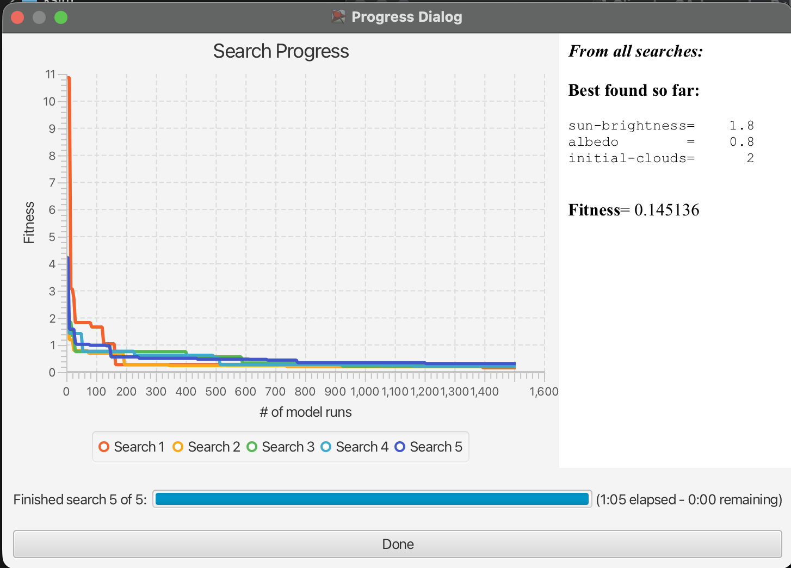
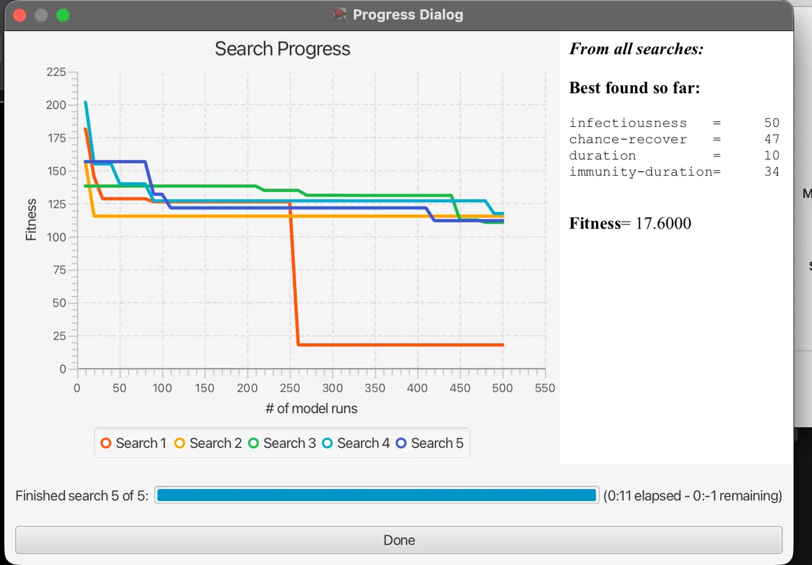
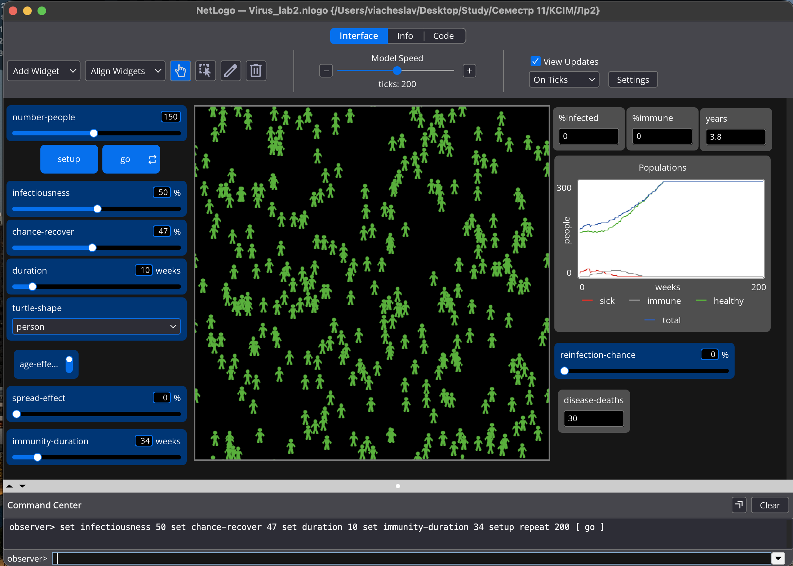

# Лабораторна робота №3. Оптимізація імітаційних моделей (Virus)

Варіант 3: Virus (Biology). Інструмент: BehaviorSearch 1.10 (у складі NetLogo 7.0.4). Модель: `Virus_lab2.nlogo` з лабораторної №2.

## 1. Модель

Агентна модель поширення хвороби серед людей, що рухаються по полю. Людина буває здоровою, хворою або імунною.

Керуючі параметри (слайдери):

| Параметр | Що задає | Значення за замовчуванням |
|---|---|---|
| `number-people` | кількість людей на старті | 150 |
| `infectiousness` | заразність, % | 80 |
| `chance-recover` | шанс одужати, % | 75 |
| `duration` | тривалість хвороби, тижні | 20 |
| `immunity-duration` | тривалість імунітету, тижні | 52 |
| `reinfection-chance`, `spread-effect`, `age-effect` | розширення з лабораторної №2 | 0 |

Показники: `%infected`, `%immune`, `years`, `disease-deaths` (кількість смертей від хвороби), графік Populations.

## 2. Налаштування BehaviorSearch

- Setup: `setup`, Step: `go`, Step limit: 200 тіків, Stop if: `false`.
- Параметри пошуку (діапазон, крок 1):
  - `infectiousness` [50, 99]
  - `chance-recover` [0, 50]
  - `duration` [10, 99]
  - `immunity-duration` [0, 260]
- Цільова функція: **мінімізувати `disease-deaths`** на останньому кроці (`AT_FINAL_STEP`), 10 повторів на набір параметрів, значення об'єднуються як `MEAN`.
- Випадковий пошук (`RandomSearch`): Evaluation limit 300 запусків моделі (30 наборів параметрів на пошук).
- Простий ГА (`StandardGA`): population-size 50, tournament-size 3, crossover-rate 0.7, mutation-rate 0.01, population-model generational, GrayBinaryChromosome, fitness caching. Evaluation limit 300 запусків моделі.
- Для кожного методу виконано 5 незалежних пошуків.

Файли налаштувань: `Virus_GA3.bsearch`, `Virus_Random3.bsearch`.

## 3. Попередній етап: вибір цільової функції

Спершу цільовою функцією був `%infected` на кінець симуляції (мінімум). Усі пошуки швидко знаходили значення 0. Перевірка в NetLogo показала, що найкращі набори (наприклад, `infectiousness` 64, `chance-recover` 6, `duration` 62, `immunity-duration` 239) дають `disease-deaths` = 194 при 150 людях на старті: епідемія згасала, бо вмирали майже всі, хто міг захворіти. Показник `%infected` у кінці заохочує смертельні набори, тому цільову функцію замінено на `disease-deaths`, а діапазони `infectiousness` і `chance-recover` звужено.

## 4. Результати

Найкраще значення цільової функції (середня кількість смертей по 10 повторах) у кожному з 5 пошуків:

| Пошук | Random Search | Genetic Algorithm |
|---|---|---|
| 1 | 108,2 | 17,6 |
| 2 | 113,1 | 115,1 |
| 3 | 112,3 | 110,4 |
| 4 | 122,1 | 117,1 |
| 5 | 114,6 | 111,7 |
| **Середнє** | **114,1** | **94,4** |
| **Медіана** | **113,1** | **111,7** |

Графіки прогресу пошуку (5 пошуків на метод):





Найкращий знайдений набір (GA, пошук 1): `infectiousness` 50, `chance-recover` 47, `duration` 10, `immunity-duration` 34, fitness 17,6.

## 5. Перевірка знайденого набору в NetLogo

Команда в Command Center:

```
set infectiousness 50 set chance-recover 47 set duration 10 set immunity-duration 34 setup repeat 200 [ go ]
```

Результат через 200 тіків: `disease-deaths` = 30, хворих немає, чисельність населення зросла (див. скріншот). Значення 30 відрізняється від 17,6, бо BehaviorSearch усереднює 10 запусків, а на скріншоті один випадковий запуск.



## 6. Висновки

- Середнє найкращих значень у ГА (94,4) нижче, ніж у випадкового пошуку (114,1), але медіани майже однакові (111,7 і 113,1). Різницю створює один вдалий пошук ГА, тому на 5 пошуках перевагу ГА довести не можна.
- Ліміт 300 запусків моделі при population-size 50 і 10 повторах означає, що ГА виконав лише одне покоління (50 наборів, 500 запусків), тобто фактично зробив випадкову вибірку без еволюції. Випадковий пошук перевірив 30 наборів. Для порівняння методів потрібен більший бюджет (наприклад, population-size 10 і ліміт 3000 запусків) і однакова кількість наборів у обох методів.
- Область з малою кількістю смертей вузька (мінімальна заразність, мінімальна тривалість хвороби, високий шанс одужання). Більшість простору дає 110–250 смертей, тому випадкові набори потрапляють у неї рідко.
- Вибір цільової функції критичний: мінімізація `%infected` давала формально ідеальний, але небажаний результат.
