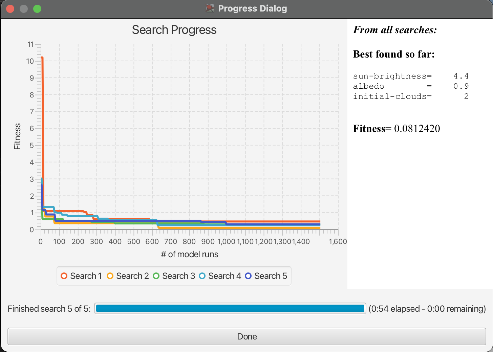
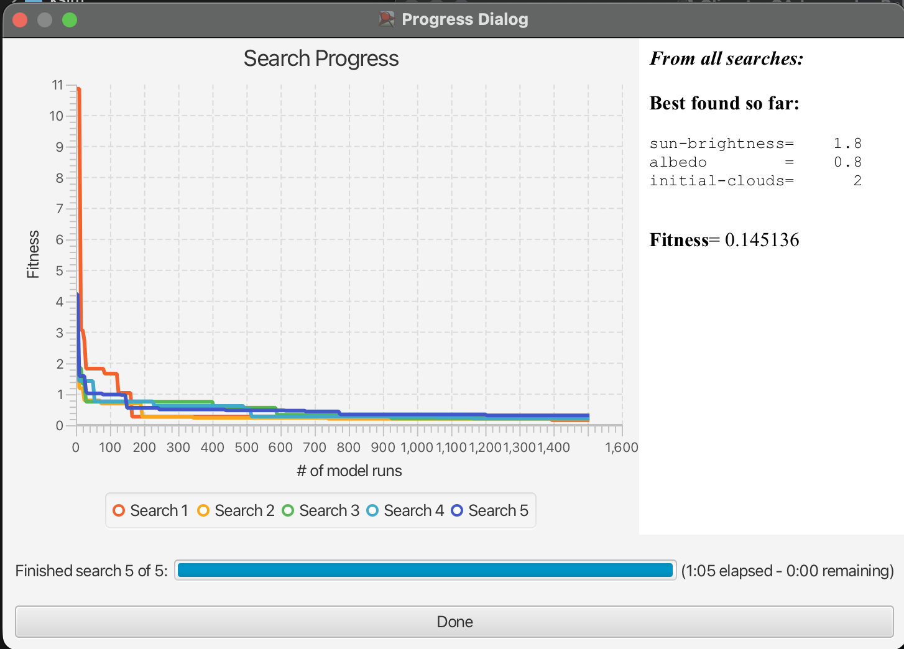
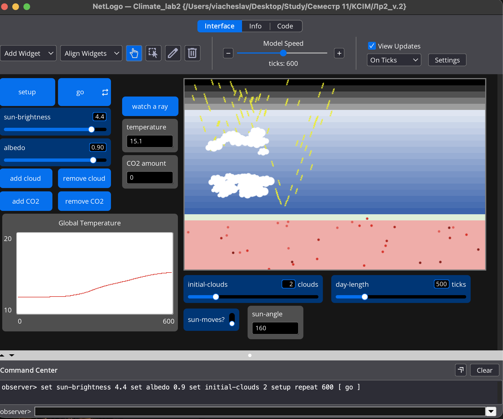

# Лабораторна робота №3. Оптимізація імітаційних моделей (Climate Change)

Варіант 2: Climate Change. Інструмент: BehaviorSearch 1.10 (у складі NetLogo 7.0.4). Модель: `Climate_lab2.nlogox` з лабораторної №2.

## 1. Модель

Агентна модель парникового ефекту: сонячні промені нагрівають поверхню, а хмари, відбивна здатність поверхні та CO2 впливають на глобальну температуру `temperature`.

Керуючі параметри (слайдери):

| Параметр | Діапазон слайдера | У запуску |
|---|---|---|
| `sun-brightness` | 0–5, крок 0,2 | змінювався |
| `albedo` | 0–1, крок 0,05 | змінювався |
| `initial-clouds` | 0–10, крок 1 | змінювався |
| `day-length`, `sun-moves?` | | значення за замовчуванням |

Показники: `temperature`, `CO2 amount`, `sun-angle`, графік Global Temperature.

## 2. Налаштування BehaviorSearch

- Setup: `setup`, Step: `go`, Step limit: 600 тіків, Stop if: `false`.
- Параметри пошуку: `sun-brightness` [0; 5] крок 0,2; `albedo` [0; 1] крок 0,05; `initial-clouds` [0; 10] крок 1.
- Цільова функція: **мінімізувати `abs (temperature - 15)`** на останньому кроці (`AT_FINAL_STEP`), 5 повторів на набір, `MEAN`.
- Випадковий пошук (`RandomSearch`): Evaluation limit 1500 запусків моделі (300 наборів на пошук).
- Простий ГА (`StandardGA`): population-size 50, tournament-size 3, crossover-rate 0.7, mutation-rate 0.01, population-model generational, GrayBinaryChromosome, fitness caching. Evaluation limit 1500 запусків (300 наборів = 6 поколінь по 50).
- Для кожного методу виконано 5 незалежних пошуків.

Файли налаштувань: `Climate_GA.bsearch`, `Climate_Random.bsearch`.

## 3. Результати

Найкраще значення цільової функції (середнє відхилення температури від 15) за пошуками:

| Пошук | Random Search | Genetic Algorithm |
|---|---|---|
| 1 | 0,454 | 0,145 |
| 2 | 0,081 | 0,188 |
| 3 | 0,278 | 0,197 |
| 4 | 0,231 | 0,195 |
| 5 | 0,285 | 0,296 |
| **Середнє** | **0,266** | **0,204** |
| **Медіана** | **0,278** | **0,195** |

Найкращий набір Random Search (пошук 2): `sun-brightness` 4,4, `albedo` 0,9, `initial-clouds` 2, значення 0,081.
Найкращий набір Genetic Algorithm (пошук 1): `sun-brightness` 1,8, `albedo` 0,8, `initial-clouds` 2, значення 0,145.

Прогрес Random Search:



Прогрес Genetic Algorithm:



## 4. Перевірка в NetLogo

Набір Random Search перевірено командою:

```
set sun-brightness 4.4 set albedo 0.9 set initial-clouds 2 setup repeat 600 [ go ]
```

Через 600 тактів `temperature` = 15,1 (відхилення 0,1), що узгоджується зі значенням 0,081 з BehaviorSearch.



## 5. Висновки

- Обидва методи знайшли набори, за яких температура на 600-му такті відрізняється від 15 менш ніж на 0,3 (крім одного пошуку Random Search: 0,454).
- Genetic Algorithm стабільніший: середнє 0,204 проти 0,266, медіана 0,195 проти 0,278, усі п'ять пошуків не гірші за 0,30. Найкращий окремий результат (0,081) належить Random Search, але це один вдалий пошук з п'яти, тому на такій малій вибірці перевагу цього методу довести не можна.
- Набори з близькою якістю лежать на «долині» компенсації: велика яскравість сонця поєднується з великим альбедо (4,4 та 0,9; 1,8 та 0,8), і температура майже однакова. Тому різні пошуки знаходять різні набори з подібним значенням цільової функції.
- На 600-му такті температура в моделі ще змінюється, тож знайдені набори оптимальні для цього моменту, а не для сталого стану.
- Бюджет 1500 запусків при population-size 50 і 5 повторах дає GA 6 поколінь, тож на відміну від варіанта 3 еволюція тут відбувається.
